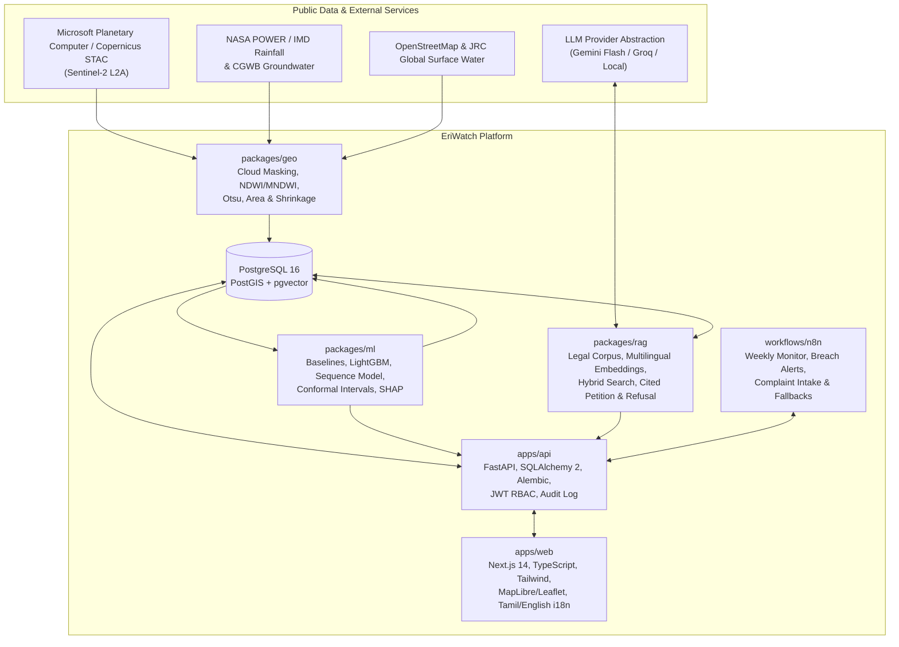

# EriWatch: Satellite-Based Early Warning and Grievance Platform for Village Irrigation Tanks

**EriWatch** is an end-to-end geospatial monitoring, hydrological forecasting, and grounded legal-petition platform built for Tamil Nadu's traditional village irrigation tanks (*eris*).

---

## 1. The Problem

Tamil Nadu relies on tens of thousands of traditional irrigation tanks (*eris*) to irrigate crops, recharge rural aquifers, and buffer extreme monsoon runoff—especially in the flood-prone Chennai, Kancheepuram, and Chengalpattu basins. Today, these tanks face three compounding crises:

1. **Unmonitored Hydrological Extremes:** Tanks dry out prematurely ahead of the *Samba*/*Navarai* cropping seasons or breach during Northeast Monsoon surges because field inspections are manual and infrequent.
2. **Silent Shrinkage & Encroachment:** Gradual siltation and illegal encroachment permanently erode tank storage capacity against historical maximum boundaries.
3. **Opaque Grievance Redressal:** When villagers or panchayat leaders observe a damaged sluice, blocked supply channel, or encroachment, they rarely know which department officer holds jurisdiction or which specific Government Order (G.O.), *Kudimaramath* guideline, or High Court/NGT directive backs their claim.

## 2. Project Vision

EriWatch closes the loop from **orbital observation** to **legally grounded civic action**:

- **Automated Satellite Water-Spread Monitoring (`packages/geo`):** Fetches 10 m Sentinel-2 L2A imagery via STAC, masks clouds/shadows using the Scene Classification Layer (SCL), computes NDWI and MNDWI water masks with adaptive Otsu thresholding, and tracks water-spread area (hectares) across pilot tanks in Chengalpattu and Kancheepuram districts.
- **30-Day Forecasting & Risk Classification (`packages/ml`):** Combines historical water spread, NASA POWER / IMD rainfall, groundwater depth, and tank typology to forecast 30-day water spread (with calibrated prediction intervals) and flag `likely_dry_before_crop_season` or `overflow_risk_this_monsoon`. Includes SHAP explainability and persistent-water shrinkage detection.
- **Grounded Legal RAG & Petition Engine (`packages/rag`):** Not a generic chatbot. Accepts field complaints in **Tamil, Tanglish, or English**, extracts a validated structured complaint schema, links the tank geospatially, retrieves relevant clauses from public Water Resources Department (WRD) orders, *Kudimaramath* guidelines, and court judgments, and drafts an officer-addressed petition with strict inline citations. If no authoritative passage supports a legal claim, the system **explicitly refuses** rather than hallucinating.
- **Automated Weekly Pipeline (`workflows/n8n`):** Scheduled weekly workflows ingest new satellite passes, compute water spread, run inference, generate evidence reports on breaches, dispatch alerts, and handle cloudy passes with fallback and retry logic. Every petition requires human-in-the-loop review before dispatch.

## 3. Architecture Sketch



## 4. Repository Structure

```text
eriwatch/
  apps/
    web/            Next.js 14 (App Router, TypeScript, Tailwind, MapLibre/Leaflet)
    api/            FastAPI, SQLAlchemy 2, Alembic, Pydantic v2
  packages/
    geo/            Satellite ingestion, SCL cloud masking, NDWI/MNDWI water masks, tank registry
    ml/             Feature engineering, baselines, LightGBM/sequence models, SHAP, evaluation
    rag/            Legal corpus ingestion, chunking, embeddings, hybrid retrieval, eval harness
  workflows/
    n8n/            Exported workflow JSONs, credential templates, operational runbook
  infra/
    docker/         Dockerfiles and docker-compose.yml (PostGIS + pgvector, API, Web, n8n)
    github/         GitHub Actions CI and scheduled satellite pipelines
  data/
    raw/ interim/ processed/   Manifests, pilot tank registry, and sample fixtures
  notebooks/        Reproducible EDA and modelling notebooks
  docs/
    adr/ reviews/ data/ modules/ api/ manual/ report/
  PROGRESS.md       Live engineering status board
  Makefile          Standard developer entrypoints (setup, lint, test, run, db-up, db-reset)
```

## 5. Quickstart

```bash
make setup
make test
make run
```

See [`PROGRESS.md`](PROGRESS.md) for current build status and [`docs/MASTER_PROMPT.md`](docs/MASTER_PROMPT.md) for the full stage-gated specification.

## 6. Licence

Released under the [MIT License](LICENSE). All satellite, meteorological, hydrological, and legal documents used by EriWatch are sourced from public-domain or open-government portals with full attribution in `docs/data/`.
